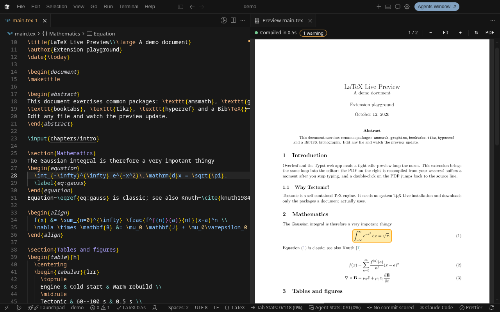
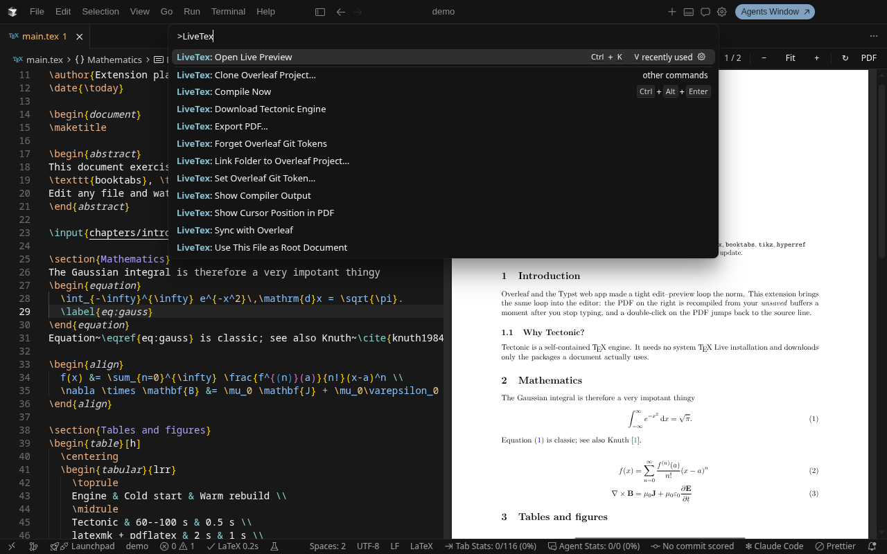

# LiveTex

LiveTex is a VS Code and Cursor extension that allows you to preview the live changes made to your `.tex` files and export them as PDF directly inside your editor. Projects can also be kept in two-way sync with Overleaf through its Git integration.

## Features

### Live preview while you type

The PDF recompiles from your **unsaved** buffers about a second after you stop typing. Your files on disk are never touched, and unsaved edits in other project files, such as chapters included with `\input`, show up too.

### No setup

Already have TeX Live, TinyTeX, MacTeX or MiKTeX? LiveTex finds it, even when it isn't on the editor's `PATH`, and builds with `latexmk` just like Overleaf.

If no TeX engine is installed, LiveTex offers to download [Tectonic](https://tectonic-typesetting.github.io), a single self-contained binary that fetches the packages your document needs. Nothing is installed system-wide.

### SyncTeX support

- **Double-click** (or Ctrl/Cmd-click) in the PDF to jump to the matching source line.
- **Move the cursor** in the editor and the matching spot in the PDF is highlighted.

### Two-way sync with Overleaf

Link a local folder to an Overleaf project, or clone one, through Overleaf's Git integration. Then sync with one click from the status bar or the preview toolbar:

- See at a glance whether you have changes to upload (`↑`) or Overleaf changes waiting (`↓n`).
- Conflicts open in the editor's merge tools, and nothing is ever force-pushed.
- Optionally pull Overleaf changes automatically when the window gains focus.

### Errors

TeX errors and warnings appear on the right file and line, even inside included files. Like Overleaf, the PDF still renders when there are errors.

### Settings and utilities

- Multi-file documents with `% !TEX root = main.tex`, or automatic root detection.
- Per-document engine with `% !TEX program = xelatex | pdflatex | lualatex`.
- A project `latexmkrc` is used, as on Overleaf.
- Saving writes `<root>.pdf` next to your document, and **Export PDF…** saves a copy anywhere.
- Changes made by git, scripts or AI agents are picked up and recompiled.

## Getting Started

1. Open a `.tex` file.
2. Click the preview icon in the editor title bar, or press `Ctrl+K V` (`Cmd+K V` on macOS).
3. If no TeX engine is found, accept the offer to download Tectonic. The first compile downloads your document's packages (30–100 s for a typical article); after that, rebuilds take about a second.

To sync with Overleaf, create a Git token in Overleaf under **Account Settings → Git Integration**, then run **LiveTex: Clone Overleaf Project…** or **LiveTex: Link Folder to Overleaf Project…**. Overleaf's Git integration requires a plan that includes it.

## Commands

| Command                                   | Shortcut         |
| ----------------------------------------- | ---------------- |
| LiveTex: Open Live Preview                | `Ctrl+K V`       |
| LiveTex: Compile Now                      | `Ctrl+Alt+Enter` |
| LiveTex: Export PDF…                      |                  |
| LiveTex: Show Cursor Position in PDF      |                  |
| LiveTex: Use This File as Root Document   |                  |
| LiveTex: Sync with Overleaf               |                  |
| LiveTex: Clone Overleaf Project…          |                  |
| LiveTex: Link Folder to Overleaf Project… |                  |

All commands are available from the Command Palette under **LiveTex**.

## Extension Settings

| Setting                        | Default  | Description                                                             |
| ------------------------------ | -------- | ----------------------------------------------------------------------- |
| `livetex.engine`               | `auto`   | `auto` uses an installed TeX distribution if found, otherwise Tectonic  |
| `livetex.compileOn`            | `change` | Recompile on `change` (live), `save`, or `manual`                       |
| `livetex.debounceMs`           | `250`    | Idle time before a live rebuild                                         |
| `livetex.pdfOnSave`            | `true`   | Write `<root>.pdf` next to the root file on save                        |
| `livetex.syncOnCursorMove`     | `true`   | Highlight the cursor's position in the PDF                              |
| `livetex.continueOnErrors`     | `true`   | Still produce a PDF when TeX reports errors                             |
| `livetex.invertPdfInDarkTheme` | `false`  | Dark-mode friendly page colours                                         |
| `livetex.shellEscape`          | `false`  | Enable `\write18` (needed by minted). Only for trusted documents        |
| `livetex.texBinPath`           | `""`     | `bin` directory of your TeX distribution, if not detected automatically |
| `livetex.overleaf.autoPull`    | `true`   | Download Overleaf changes when the window gains focus                   |
| `livetex.overleaf.pushOnSave`  | `false`  | Sync with Overleaf 15 s after the last save                             |

See the Settings UI under **Extensions → LiveTex** for the full list.

## Known Issues

- Tectonic is XeTeX-based. Documents written for pdfLaTeX with `fontenc`/`inputenc`, or using `biblatex` with biber, need a TeX distribution; LiveTex switches to `latexmk` automatically when one is installed.
- Overleaf's Git integration has one branch and no Git LFS or submodules. Renames drop Overleaf comments on that file.

## Feedback

Found a bug or have an idea? [Open an issue on GitHub](https://github.com/pFornagiel/livetex/issues). Documentation for contributors is in the [repository README](https://github.com/pFornagiel/livetex#readme).